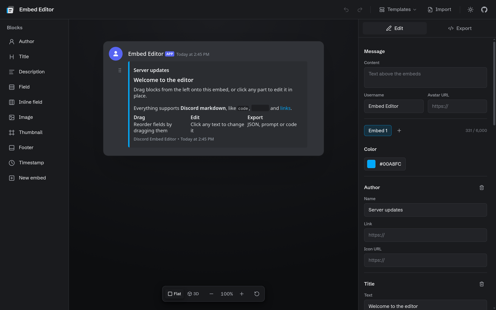
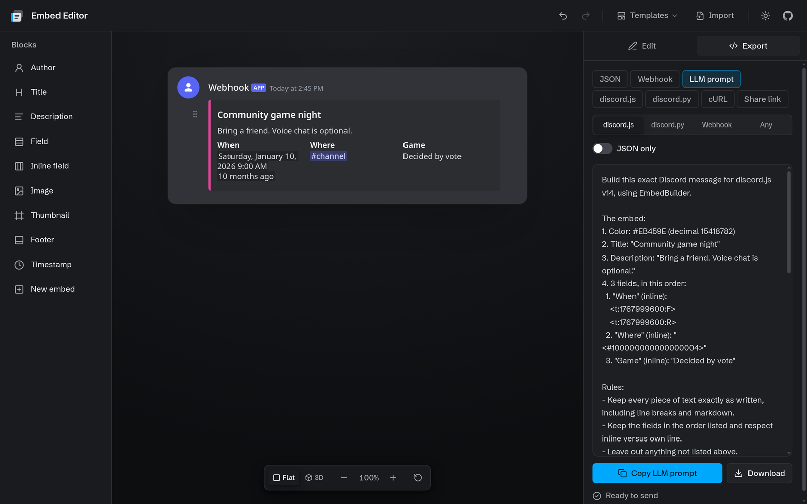
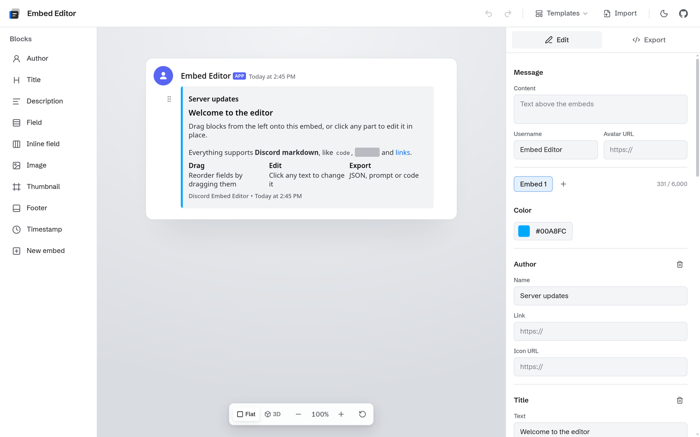
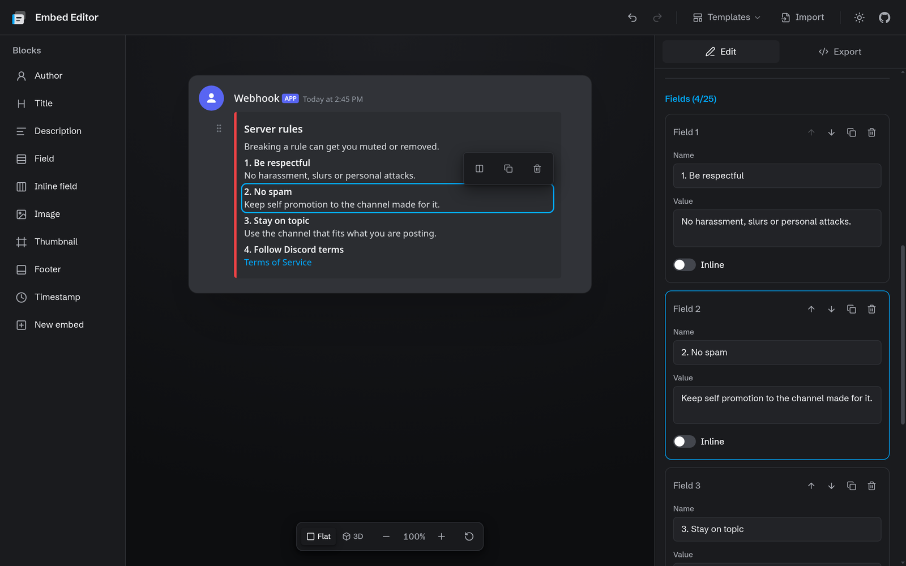
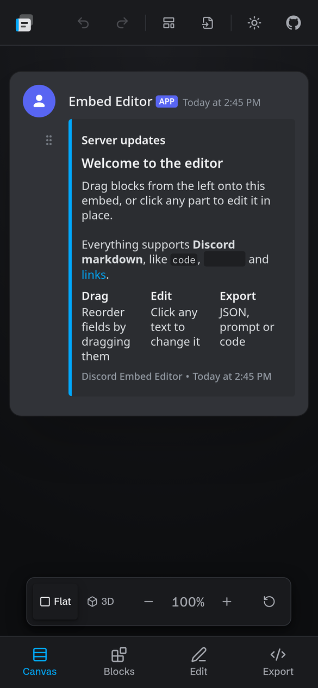
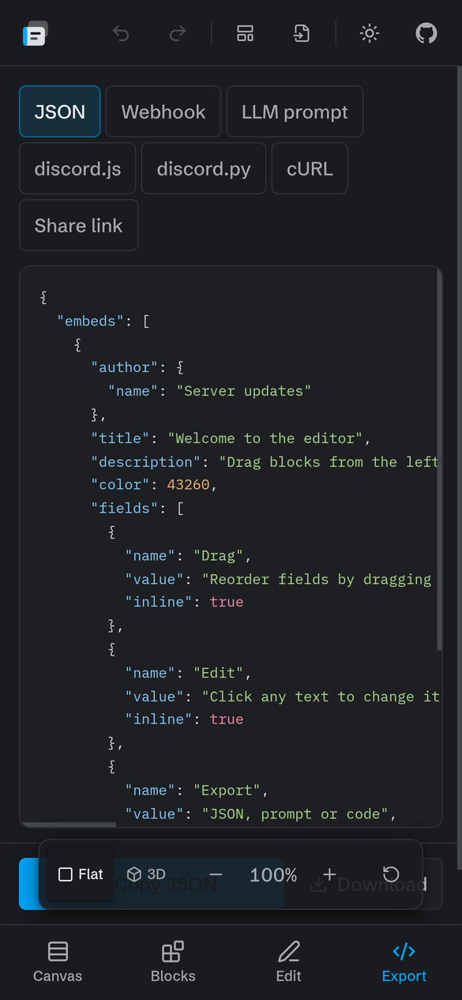

<p align="center">
  
</p>

<h1 align="center">Discord Embed Editor</h1>

<p align="center">
  Build Discord embeds visually with drag and drop, then copy them as JSON, code or a ready-to-paste LLM prompt.
</p>

<p align="center">
  <a href="https://02sila.github.io/discord-embed-editor/"><strong>Open the editor</strong></a>
</p>

<p align="center">
  
</p>

## Features

- **Drag and drop.** Pull blocks (author, title, description, fields, images, footer, timestamp) onto an embed, drag fields to reorder them, drag whole embeds to change their order.
- **Edit in place.** Click any part of the preview and type. The inspector on the right mirrors every value, with Discord's character limits shown as you approach them.
- **Live preview.** The canvas renders the message the way Discord does, including the field grid, thumbnails and footers. Pinch or Ctrl + scroll to zoom.
- **Discord markdown.** Bold, italic, underline, strikethrough, spoilers, code blocks, quotes, lists, headings, masked links, mentions and `<t:...>` timestamps render the way Discord shows them.
- **Up to 10 embeds** per message, plus message content, webhook username and avatar.
- **Templates, import and undo.** Start from a template, paste existing JSON (embed, embeds array, webhook payload), and undo or redo any change. Work is saved in your browser automatically.
- **Light and dark** themes, keyboard support throughout, and a touch layout for phones and tablets.

## Exports

| Format | What you get |
| --- | --- |
| JSON | The `embeds` array, ready for any bot or API call |
| Webhook | A full webhook payload with content, username and avatar |
| LLM prompt | A plain-language description of the embed plus the exact JSON, written for discord.js, discord.py, a raw webhook or any library |
| discord.js | `EmbedBuilder` code for discord.js v14 |
| discord.py | `discord.Embed` code for discord.py 2.x |
| cURL | A command that posts the message to a webhook |
| Share link | A URL that opens the editor with your embed loaded |

The LLM prompt is generated by a fixed template, not by an AI model, so the same embed always produces the same prompt.

Before you copy anything, the export panel lists anything Discord would reject: empty field names, text over the limits, invalid URLs.

<p align="center">
  
</p>

<p align="center">
  
  
</p>

<p align="center">
  
  
</p>

## Getting started

Requires Node.js 22.12 or newer.

```bash
git clone https://github.com/02Sila/discord-embed-editor.git
cd discord-embed-editor
npm install
npm run dev
```

Then open http://127.0.0.1:5180.

| Command | Description |
| --- | --- |
| `npm run dev` | Start the dev server |
| `npm run build` | Type-check and build to `dist/` |
| `npm test` | Run the unit tests |
| `npm run typecheck` | Type-check only |

The build is a static site, so `dist/` can be hosted anywhere.

## Keyboard shortcuts

| Keys | Action |
| --- | --- |
| Ctrl + Z | Undo |
| Ctrl + Shift + Z or Ctrl + Y | Redo |
| Delete | Remove the selected part |
| Escape | Stop editing, clear the selection |
| Enter | Add a focused block from the palette |
| Ctrl + Enter | Load JSON in the import dialog |

## Built with

React, TypeScript, Vite, [dnd-kit](https://dndkit.com) and [Zustand](https://zustand.docs.pmnd.rs).

## License

[MIT](LICENSE)
